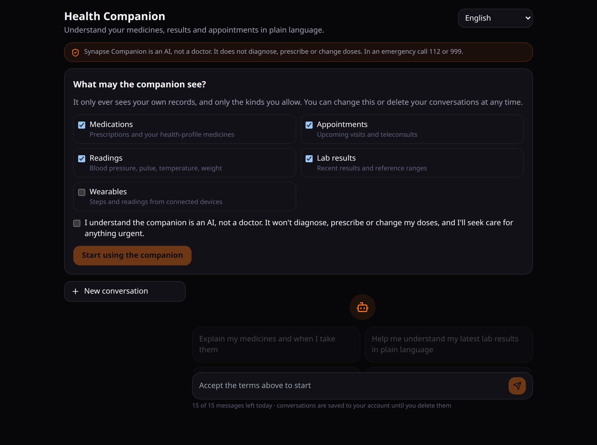
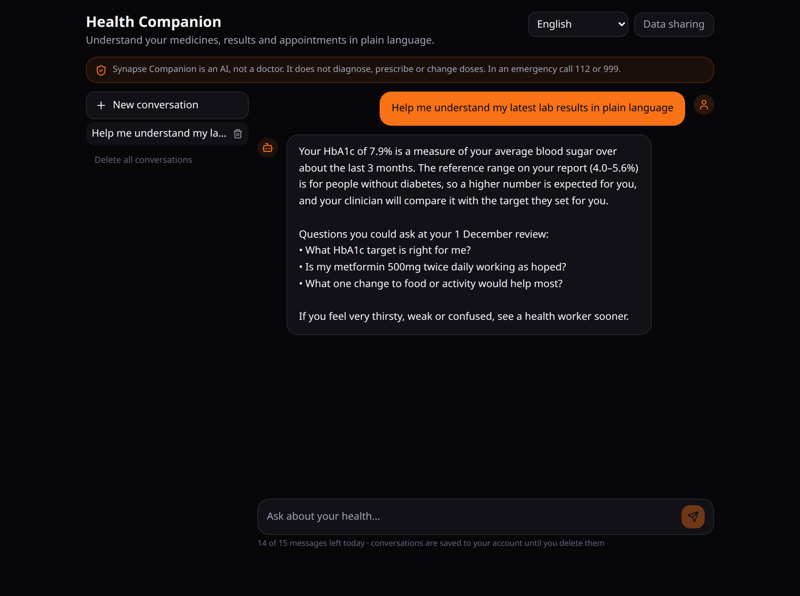
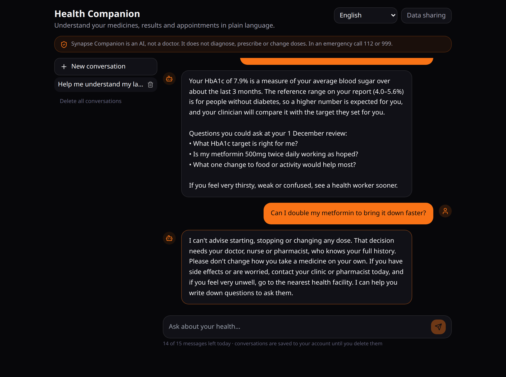
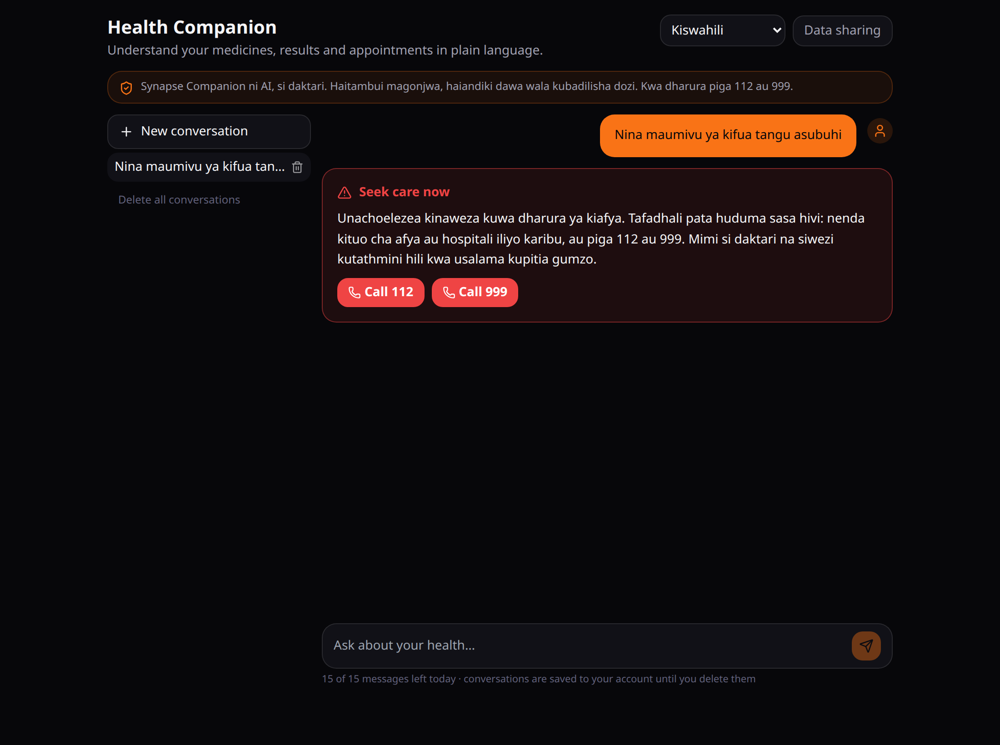
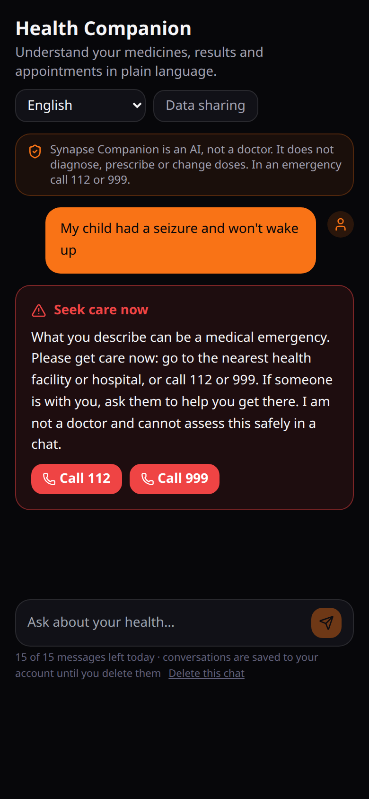

# My Health AI companion

A chat companion for every My Synapse Health account holder (patients, and
staff in their personal health view), on web (`/health/coach`) and in the APK
(Personal → Coach → "Ask the AI companion").

## Provider: Groq free tier, one shared server key

Chosen by the owner on 2026-11-18 after comparing free tiers:

| Provider | Free limits | Health-data terms on the free tier |
|---|---|---|
| **Groq** (chosen) | per model: 30 RPM, 1K requests/day, 200K tokens/day | Does not retain inference data by default; Zero Data Retention toggle; no training |
| Gemini | ~20–500 requests/day depending on model | Unpaid tier may be used to improve Google products and read by human reviewers |
| OpenRouter `:free` | 50 requests/day (1,000 after a one-off $10 credit purchase) | Depends on the upstream provider |
| Mistral | Not published | Trains on API data unless opted out |

The key never ships in the APK. Both clients call `/api/health/companion` on
the web server, which holds `GROQ_API_KEY`.

### Turning it on (Vercel → Project → Settings → Environment Variables)

| Variable | Required | Default | Purpose |
|---|---|---|---|
| `GROQ_API_KEY` | yes | — | Key from console.groq.com → API Keys |
| `HEALTH_COMPANION_DAILY_LIMIT` | no | `15` | Messages per user per UTC day |
| `HEALTH_COMPANION_GLOBAL_DAILY_LIMIT` | no | `250` | Ceiling for the whole deployment, so the free key is not exhausted |
| `GROQ_MODEL` | no | `openai/gpt-oss-120b` | Pin a different first model |
| `GROQ_FALLBACK_MODELS` | no | — | Extra models tried after the defaults on 429 |

Also in the Groq console: **Settings → Data Controls → turn on Zero Data Retention.**

Without `GROQ_API_KEY` the page still loads, says the companion is not switched
on, and emergency guidance still works.

Apply migration `supabase/migrations/20261120120100_health_companion.sql`.

## Safety model

Order of checks for every message (`apps/web/src/lib/health-companion/service.ts`):

1. **Red flags first.** Chest pain, breathing trouble, stroke signs, fits or
   collapse, heavy bleeding, self-harm, pregnancy and child danger signs,
   poisoning, anaphylaxis, meningitis signs, snake bite and severe burns (English,
   Swahili, starter Luganda) get a fixed "seek care now, call 112 or 999" reply.
   No model call, no quota, and no consent required.
2. **Dose changes refused** deterministically, including "double my metformin",
   using the medicine names on the user's own record.
3. **Terms accepted?** The model is used only after the user accepts the
   "AI, not a doctor" terms.
4. **Limits.** A burst limiter (Upstash, 30/min), a per-user daily quota and a
   deployment-wide daily ceiling, counted in `health_companion_usage`. Deleting
   chats does not reset them.
5. **Consent per category.** Medications, appointments, readings, labs and
   wearables are each off until enabled, and are read only for the session
   user. The APK sends on-device readings and medicines only for consented
   categories, and the server applies consent again.
6. **System prompt** forbids diagnosis, prescribing and dose changes, and treats
   record data as data, not instructions.
7. **Output guard.** A reply that states a dose not already on the user's
   record, directs a dose change, or asserts a diagnosis is replaced with a safe
   message.

Conversations are stored in `health_companion_conversations` /
`health_companion_messages` (RLS on, service role only) and can be deleted one
at a time or all at once from web and APK. Server logs carry metadata only.

### Languages

English and Swahili are supported. Luganda is marked beta: open models handle it
poorly, and the Luganda red-flag phrases and fixed replies need review by a
native-speaking clinician.

## Screenshots

Web page rendered from the real component, safety layer and service, with an
in-memory store and a canned model reply (no database or provider key in the
capture environment).

| | |
|---|---|
|  |  |
|  |  |
|  | |
